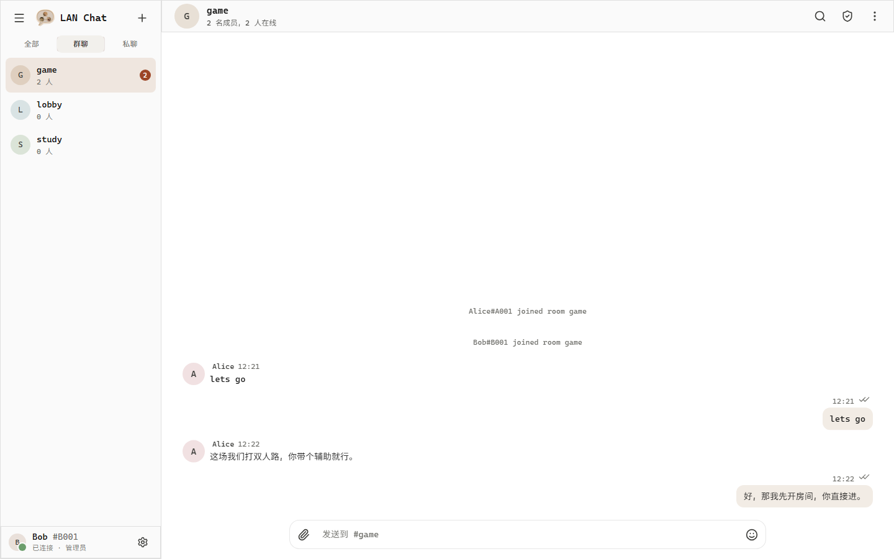

# LAN Chat

[](https://github.com/DUSK1NG/cross-language-lan-chatroom/actions/workflows/ci.yml)
[](https://github.com/DUSK1NG/cross-language-lan-chatroom/releases/latest)


Windows 聊天程序，提供两种使用方式：**局域网版**由房主在自己电脑上开房，同一局域网即可聊天；**在线版**通过独立服务器提供账号、离线消息和私信。另有 Android 在线版客户端。桌面端使用 Tauri 2 + React，服务端、协议与加密均由 Rust 实现，不依赖第三方云服务。

| 版本 | 场景 | 需要什么 |
| --- | --- | --- |
| 局域网版 `LANChat-Setup-x64.exe` | 同一局域网或虚拟局域网内开房 | 一台 Windows 主机，无需注册 |
| 在线版 `LANChat-Online-Setup-x64.exe` | 跨网络长期使用 | 自建 `lan-chat-server` + 域名与 TLS 证书 |
| Android `LANChat-Android-arm64.apk` | 手机使用在线版 | 与桌面端相同的账号 |



## 功能

**局域网版**

- 频道（`#房间`）与私信，频道支持密码、白名单和邀请
- 管理员、禁言、成员审批；每条新连接都需要房主确认
- 历史记录与全文搜索，消息撤回
- 附件分块加密上传（AES-256-GCM），附件清单由 MLS 组保护
- UDP 自动发现与手动填写地址两种连接方式，浅色 / 深色主题

**在线版**

- 注册登录（bcrypt 口令哈希）、离线消息、私信文字与图片
- 群聊与群文件、已读回执、多端同时在线
- 附件存放在数据库旁的 `.files` 目录
- 可选的 Firebase Cloud Messaging 推送（Android 通知）

**通用**

- 自动更新：HTTPS + minisign 签名校验，失败即拒绝安装
- 界面内查看版本说明

## 下载与安装

从 [Releases](https://github.com/DUSK1NG/cross-language-lan-chatroom/releases/latest) 下载：

| 文件 | 说明 |
| --- | --- |
| [LANChat-Setup-x64.exe](https://github.com/DUSK1NG/cross-language-lan-chatroom/releases/latest/download/LANChat-Setup-x64.exe) | 局域网版安装器 |
| [LANChat-Online-Setup-x64.exe](https://github.com/DUSK1NG/cross-language-lan-chatroom/releases/latest/download/LANChat-Online-Setup-x64.exe) | 在线版安装器 |
| [LANChat-Android-arm64.apk](https://github.com/DUSK1NG/cross-language-lan-chatroom/releases/latest/download/LANChat-Android-arm64.apk) | Android 在线版（arm64） |
| [SHA256SUMS](https://github.com/DUSK1NG/cross-language-lan-chatroom/releases/latest/download/SHA256SUMS) | 全部发布资产校验和 |

系统要求：Windows 10/11 x64 与 [Microsoft Edge WebView2 Runtime](https://developer.microsoft.com/microsoft-edge/webview2/)（Win11 已自带）。两个桌面版本可以同时安装。

安装包使用 minisign 签名用于**自动更新**，但没有 Authenticode 代码签名，Windows SmartScreen 可能提示“未知发布者”；请以 Releases 页面和 `SHA256SUMS` 为准。

### 第一次使用

1. **局域网版**：房主选择“创建本地聊天室”，填写用户名、用户代码和房主密码并启动。成员选择“加入局域网聊天室”，在“附近聊天室”选中房主，**通过可信渠道核对证书指纹**后申请加入，房主批准后进入。局域网用法详见 [docs/release-setup.md](docs/release-setup.md)。
2. **在线版**：填写服务器域名和端口，首次使用时注册用户名、密码和用户代码。点会话列表的加号，输入对方用户代码发起私信；对方离线时消息会在其下次登录后投递。
3. **Android**：安装 APK，用同一账号登录；在“设置 → 私信系统通知”开关推送。

## 安全模型

这是自建聊天工具，安全边界与公网 IM 不同，部署前请先读完本节。

- **传输**：客户端到服务端 TLS 1.2+。局域网版使用房主自签证书，客户端固定校验该证书；未确认过的房主必须先人工核对 SHA-256 指纹。UDP 广播本身不认证，发现到房间不等于确认了房主身份。
- **谁能读到消息**：房主服务端和在线服务器能看到消息明文，这是设计使然。附件内容使用 AES-256-GCM 加密，清单通过 MLS 组分发；附件加密用于避免明文落盘和被同网段旁观者直接读取，**不构成对房主 / 服务器管理员的保密**。
- **身份**：局域网版的身份是“用户名 + 用户代码”，不是密码；房主审批是唯一准入关口，应通过当面或电话核验。首次成功加入后账号会绑定到本机生成的设备密钥（用户数据目录的 `device-secret`），之后同一账号在另一台设备登录会被拒绝，房主“踢出”该成员即解除绑定；旧客户端不带设备密钥仍可进房，但不会收到离线私信。在线版口令使用 bcrypt（cost 10）存储。
- **更新**：仅接受 HTTPS 清单与安装包，使用编译期内置的公钥验证 minisign 签名，并校验文件大小与资产名；未配置公钥的构建会拒绝更新。
- **资源边界**：在线服务端对每个收件人的待投递消息设上限（默认 200 条 / 64 MiB、14 天过期），已送达私信默认保留 30 天，图片总量有全局预算（默认 2 GiB）；整体存储另有总预算（默认 8 GiB）、单个发送者的群消息预算（默认 1 GiB）和磁盘最小剩余空间保护（默认 2 GiB）。超限时发送方收到“稍后再试”，不会挤掉旧消息。
- **连接准入**：局域网版对未认证连接设独立于正式会话槽的预认证许可（默认全局 128、每来源 8，IPv6 按 /64 归并），TLS 握手与登录帧分别限时（默认 5 秒 / 8 秒）；房主批准后才占用正式会话槽，因此半开连接无法占满房间。
- **数据**：证书私钥、数据库、聊天记录和附件只保存在本机用户数据目录（在线附件在数据库旁的 `.files`；数据库使用 WAL，同目录还会有 `-wal` / `-shm`，备份请一并复制）。不要把这些文件提交到 Git、同步盘或 Release。

发现安全问题请按 [SECURITY.md](SECURITY.md) 私下报告，不要直接开公开 issue。

## 技术栈

| 层 | 技术 |
| --- | --- |
| 桌面壳 | Tauri 2.12、WebView2、Rust 1.85（edition 2024） |
| 前端 | React 19.2、TypeScript 6、Vite 8、Tailwind CSS 4、Radix UI、framer-motion |
| 前端测试 | Vitest 4、Testing Library、jsdom |
| 服务端 | Rust、tokio、rustls（TLS 1.2+）、rusqlite（内置 SQLite，FTS5 trigram） |
| 协议 | 自有 JSON 帧：4 字节大端长度 + UTF-8 JSON，单帧 1..=65536 字节 |
| 加密 | TLS 1.2+；附件 AES-256-GCM 分块 + `mls-rs` 0.58；更新签名 minisign |
| Android | Java（minSdk 28 / target 35）+ Rust JNI 传输层 + FCM 25 |
| 构建 | Cargo workspace、pnpm 11.19、GitHub Actions（5 个 job） |

## 仓库结构

```
protocol-rust/        线协议与消息类型（单一来源）
server-rust/          服务端：局域网房主模式 + 在线服务器
desktop-rust/         桌面端业务与会话状态机
crates/client-core/   TLS 连接、局域网发现、附件加密、更新器
apps/desktop/         Tauri 2 壳与 IPC（src-tauri）
frontend/             React + Vite 界面
android/              Android 客户端与 Rust JNI 传输
tools/bootstrap/      统一运行包启动器
scripts/              构建、打包、发布与验收脚本
docs/                 架构、协议、发布与验收文档
```

## 从源码构建

需要 Rust（含 MSVC 工具链）、Node.js、pnpm 与 WebView2。首次构建：

```powershell
pnpm.cmd --dir frontend install --frozen-lockfile
powershell.exe -NoProfile -ExecutionPolicy Bypass -File scripts/build-desktop.ps1
```

产物在 `out/desktop`，成功时最后一行以 `Desktop build:` 开头。在线版加 `-Edition online`。

自动更新需要编译期注入更新公钥，否则构建出的程序会拒绝更新：

```powershell
$env:LANCHAT_UPDATER_PUBLIC_KEY = "<minisign 公钥>"
```

### 测试

```powershell
pnpm.cmd --dir frontend run lint
pnpm.cmd --dir frontend exec vitest run
cargo test --workspace --locked
cargo clippy --workspace --all-targets --locked -- -D warnings
node scripts/check-version.mjs
```

详见 [docs/testing.md](docs/testing.md)。

## 部署在线服务端

```bash
cargo build --locked --release -p lan-chat-server
./target/release/lan-chat-server --mode online \
  --listen 0.0.0.0:8443 \
  --db /var/lib/lan-chat/chat.db \
  --cert /etc/letsencrypt/live/example.com/fullchain.pem \
  --key /etc/letsencrypt/live/example.com/privkey.pem \
  --max-clients 512
```

资源与限流参数（括号内为默认值，均可显式覆盖）：

- `--undelivered-per-target`（200）、`--undelivered-bytes-per-target`（67108864）、`--undelivered-ttl-days`（14）：每个收件人的待投递消息条数、字节数、过期天数，`0` 关闭对应限制。
- `--delivered-ttl-days`（30）：已送达私信保留天数，`0` 关闭。
- `--image-budget-bytes`（2147483648）：图片存储全局预算。
- `--storage-budget-bytes`（8589934592）：在线存储总预算；`--group-sender-budget-bytes`（1073741824）：单个发送者的群消息字节预算；`--min-disk-free-bytes`（2147483648）：数据库所在磁盘的最小剩余空间，低于该值拒绝写入新文件，`0` 关闭检查。
- `--lan-max-preauth`（128）、`--lan-max-preauth-per-ip`（8）、`--lan-tls-handshake-timeout-secs`（5）、`--lan-login-frame-timeout-secs`（8）：局域网版预认证连接的全局/每来源上限与超时。
- `--preauth-fail-limit`（8）、`--preauth-fail-window-secs`（60）、`--preauth-ban-secs`（120）：TLS 握手/登录帧失败的来源封禁。
- `--vacuum`：单独跑一次 VACUUM 回收已删除消息占用的磁盘（不启动服务，需要 `--mode online` 和 `--db`；执行前预留约等于库文件的空闲空间）。
- 其余（`--max-preauth`、`--max-preauth-per-ip`、`--max-auth-concurrency`、`--account-fail-threshold` 等）见 [计划文档](docs/plans/2026-11-27-p0-hardening-plan.md) 第 6 节。

- `--cert` / `--key` 必须是客户端所填域名或 IP 匹配的证书链与私钥。
- 附件默认写到数据库同目录的 `.files`；备份、迁移和旧附件清理见 [docs/architecture.md](docs/architecture.md#在线存储与迁移)。
- 推送需要 `--fcm-service-account`（服务账号 JSON，留在服务端）、`--fcm-relay-url`、`--fcm-relay-secret-file`，并与 APK 使用同一 Firebase 项目。
- 客户端必须能访问该 TCP 端口；跨网络或 NAT 后请配好端口映射或虚拟局域网，参考 [docs/cross-network-radmin.md](docs/cross-network-radmin.md)。

发布流程（版本号、安装器、更新清单、签名资产）见 [docs/release-runbook.md](docs/release-runbook.md) 与 [docs/github-publishing.md](docs/github-publishing.md)。

## 维护与状态

- 最新发布为 `v1.4.0`；`master` 当前为 1.4.1 开发线，已合入服务端安全加固（LAN 预认证准入、成员移除与设备绑定修复、在线存储预算、文件 IO 出锁），尚未发版。设计与计划见 [docs/superpowers/](docs/superpowers/)。分支策略：只保留 `master`，候选版本使用临时分支，合并后删除；发布以 tag `v*` 触发 [Release 工作流](.github/workflows/release.yml)。
- CI 覆盖 Rust 测试与 Clippy、前端 lint/测试/构建、Windows 桌面构建、Android 构建和源码启动器；`master` 必须保持绿色。
- 依赖锁定在 `Cargo.lock` 与 `frontend/pnpm-lock.yaml`，升级请单独提交并跑完整测试。
- 接手开发先读 [WORKLOG.md](WORKLOG.md) 与 [docs/CODEX_HANDOFF.md](docs/CODEX_HANDOFF.md)；收工前在 WORKLOG 顶部追加一条。

## 文档

| 文档 | 内容 |
| --- | --- |
| [docs/README.md](docs/README.md) | 文档总入口 |
| [docs/architecture.md](docs/architecture.md) | 运行时链路、协议、存储与安全边界 |
| [docs/protocol.md](docs/protocol.md) | 帧格式、消息类型与兼容规则 |
| [docs/known-issues.md](docs/known-issues.md) | 已知问题与规避方式 |
| [docs/release-setup.md](docs/release-setup.md) | 局域网使用说明 |
| [WORKLOG.md](WORKLOG.md) | 开发日志与当前进度 |

## 参与

欢迎 issue 与 pull request。提交前请：

1. 本地跑完上面“测试”一节的命令；
2. 不要提交证书、私钥、数据库、日志或截图中的真实账号；
3. 安全漏洞走 [SECURITY.md](SECURITY.md)，不要开公开 issue。

## 许可

本仓库目前**未附加开源许可证**，默认保留所有权利。若需再分发、修改后发布或商用，请先联系作者获取书面许可。
